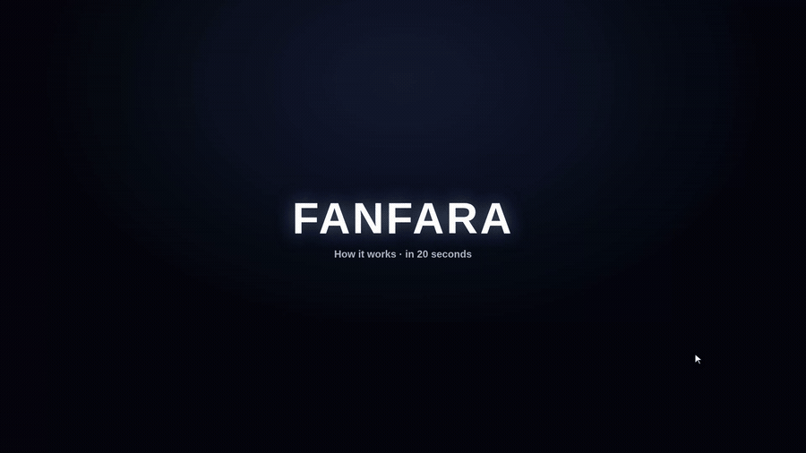

# 🎉 Fanfara

<p align="center">
  
</p>

[🇬🇧 Read in English](README.md) · **🇮🇹 Italiano**

**Rendi lo sblocco degli achievement di Steam spettacolare come su Xbox e PlayStation.**

Su Steam, quando sblocchi un achievement compare una piccola notifica anonima nell'angolo. Fanfara
la sostituisce con una notifica animata e festosa, in cui **stile, icona e suono cambiano in base
alla rarità** dell'achievement: più è raro (meno giocatori al mondo l'hanno ottenuto), più lo
sblocco è epico.

È un **overlay nativo e leggero per Windows**: non rallenta il PC e non richiede ore di
configurazione. Avvialo, gioca, e pensa a tutto lui. Inoltre tiene una **Cronologia** locale di
ogni achievement che sblocchi e trasforma tutto il tuo catalogo Steam in una **Collezione** di
carte collezionabili — creata in automatico, con icone, date e rarità reali, senza login e senza
configurazione.

---

## ⬇️ Scarica e usa (per tutti)

1. Vai nella sezione **[Releases](../../releases)** qui su GitHub.
2. Scarica l'ultima versione:
   - **`FanfaraSetup.exe`** — l'installer (consigliato): installa tutto e tiene l'app
     **aggiornata in automatico** (gli aggiornamenti vengono **verificati con un checksum SHA-256**
     prima di essere eseguiti).
   - oppure **`Fanfara.zip`** — la versione portable: estraila e avvia `Fanfara.exe`, niente da installare.
3. Avvialo.

Nient'altro da installare: niente .NET, niente terminale. È tutto incluso.

> ⚠️ **La prima volta**, Windows potrebbe mostrare l'avviso blu "Windows ha protetto il PC". È
> normale per le app gratuite non firmate con un certificato a pagamento.
> Clicca **"Ulteriori informazioni"** → **"Esegui comunque"**.

Fanfara si apre in **un'unica finestra** con una breve animazione del logo, poi una **Home** con
quattro aree: **Personalizza** (stili e impostazioni), **Cronologia** (lo storico degli sblocchi),
**Collezione** (la raccolta di carte) e **Guida** (la guida nell'app). Tutto avviene dentro questa
unica finestra — non si aprono altre finestre. Scegli uno stile, la posizione sullo schermo e la
durata, e provali subito con il pulsante **Prova**. Ogni stile ha già il suo suono — niente altro
da configurare. Dopo averla chiusa, Fanfara resta attiva con un'icona vicino all'orologio (in basso
a destra): cliccala per riaprirla o uscire.

Poi avvia Steam, gioca, e la fanfara comparirà al primo achievement sbloccato. 🎮

### Consiglio: disattiva la notifica di Steam
Per evitare i doppioni, puoi disattivare quella predefinita di Steam:
**Steam → Impostazioni → Nel gioco** (o **Notifiche**) → disattiva la notifica di sblocco achievement.

---

## ✨ Cosa include

- **Stili di notifica organizzati in 8 schede**:
  **Base · Console · Fantasy · Capcom · Square-Enix · Microsoft · Ubisoft · CD Projekt**.
- Ogni stile ha un **box unico**, un'**icona diversa per ogni rarità** e un **suono integrato** —
  tutto **in 3D e animato**. (Niente selettore separato del suono: il suono fa parte dello stile.)
- **10 stili Base originali e astratti**: Onda, Pulsar, Mosaico, Numero, Carica, Coriandoli, Nebula,
  Tratto, Piega, Orbita.
- Pacchetti ispirati ai giochi con **emblemi e suoni originali** (nessun logo o audio ufficiale):
  Capcom, Square-Enix, Microsoft/Xbox, Ubisoft, CD Projekt (The Witcher, Cyberpunk 2077…).
- **🕒 Cronologia** — uno storico locale e consultabile di ogni achievement che sblocchi: raggruppato
  per giorno, con **filtro per anno**, chip di rarità e ricerca, più un riepilogo con le statistiche.
  Impaginato (25 per pagina) per restare veloce anche con migliaia di obiettivi.
- **🃏 Collezione** — tutto il tuo catalogo di achievement Steam come **carte collezionabili animate**
  con icone, descrizioni e rarità reali, ciascuna con una leggera inclinazione 3D. Anch'essa impaginata.
- **☁️ Importazione e sincronizzazione automatica da Steam** — la prima volta Fanfara **importa tutti
  i tuoi achievement passati** (icone reali, date di sblocco e rarità mondiale) **senza login e senza
  inserire alcuna chiave API**. Si aggiorna periodicamente e cattura i nuovi sblocchi dal vivo, così
  Cronologia e Collezione restano sempre aggiornate da sole. Funziona tramite un piccolo proxy
  personale che mantiene privata la chiave API.
- **5 rarità** che cambiano icona, colore, intensità ed effetti — Comune, Non comune, Raro, Epico,
  Leggendario — e il **Leggendario ha sempre qualcosa in più** ✨.
- **5 lingue** — Italiano, Inglese, Francese, Tedesco e Spagnolo. L'app segue in automatico la
  lingua di Windows, oppure puoi sceglierla nelle Impostazioni; **è tutto tradotto**, fino alla
  scala dei ranghi a tema di ogni stile. Anche l'installer segue la lingua del sistema.
- **7 posizioni** sullo schermo, durata regolabile, **tema chiaro/scuro ovunque**, **avvio con
  Windows** e **aggiornamenti automatici** (verificati con SHA-256).
- **Funziona anche nei giochi a schermo intero e senza bordi** — Fanfara prepara da sola i tuoi giochi Steam perché le notifiche compaiano in gioco, senza configurazione.
- Notifiche **grandi e leggibili**, perfette su monitor ampi e ad alta risoluzione.

---

## 🛠️ Per sviluppatori (compilalo da solo)

Ti serve solo il **.NET 8 SDK** (gratis): https://dotnet.microsoft.com/download

Nella cartella `src/`:

```bat
dotnet run
```

per avviarlo in sviluppo, oppure per creare il pacchetto distribuibile:

```bat
dotnet publish -c Release
```

L'app finita è *self-contained* (include il runtime .NET), quindi la cartella è autonoma e portabile
su qualunque PC Windows.

> L'app deve girare **sul PC dove gira Steam**. Fanfara comunica con il gioco in esecuzione tramite
> l'API Steamworks come se fosse quel gioco (senza chiave API). L'importazione di Cronologia e
> Collezione usa invece l'API **Web** di Steam in sola lettura, tramite il proxy in `proxy/` (vedi
> sotto), così gli utenti finali non inseriscono mai una chiave.

### Pubblicare una nuova versione
Il repo include `.github/workflows/build.yml`. Quando pubblichi una **Release** con un **tag** che
inizia con `v` (es. `v0.2.0`), GitHub compila l'app sui propri server Windows e allega
automaticamente `Fanfara.zip`, `FanfaraSetup.exe` **e** `FanfaraSetup.exe.sha256` (il checksum che
l'auto-updater verifica) alla Release. Nessuna compilazione manuale.

---

## ⚙️ Come funziona (in breve)

- `SteamWatcher.cs` — il supervisore. Avvia un **processo Steam separato** per il gioco in
  esecuzione, così l'app principale non carica mai Steam direttamente (questo mantiene Fanfara
  stabile ed evita che il gioco risulti "ancora in esecuzione" dopo che esci). Riavvia anche il
  processo se va in crash.
- `SteamWorker.cs` — il processo figlio. Inizializza l'API Steamworks **come il gioco in
  esecuzione**, controlla ogni secondo se è stato sbloccato un nuovo achievement (leggendo la
  percentuale di rarità mondiale) e rileva quando il gioco si chiude. Comunica gli sblocchi all'app.
- `OverlayWindow` — una finestra trasparente, sempre in primo piano e *click-through*, che copre lo
  schermo e ospita una WebView2.
- `web/notify.html` — la grafica delle notifiche: gli stili che disegnano lo sblocco con il box,
  l'icona e il suono giusti; la rarità decide colori ed effetti.
- **L'interfaccia a finestra unica** — una sola WebView2 che naviga tra `web/home.html` (intro col
  logo + Home), `web/settings.html` (stili e impostazioni), `web/history.html` (Cronologia),
  `web/collection.html` (Collezione) e `web/guide.html` (la guida). Ogni pagina segue il tema
  chiaro/scuro e la lingua scelta.
- `SteamId.cs` — trova il tuo SteamID64 in locale (dalle chiavi di registro di Steam /
  `loginusers.vdf`), così l'importazione non richiede nulla da te.
- `SteamHistory.cs` + `AchievementStore.cs` — il backfill e l'archivio locale. Recuperano i tuoi
  giochi posseduti e gli achievement di ciascuno (icone, date di sblocco, rarità) in parallelo e li
  salvano in `history.json`, senza duplicati e tenuti aggiornati.
- `proxy/worker.js` — un piccolo **Cloudflare Worker** che fa da proxy all'API Web di Steam e
  **tiene la chiave API come segreto privato**, così l'app (e ogni utente) funziona a configurazione
  zero.
- `Updater.cs` — controlla su GitHub se c'è una Release più recente, **scarica l'installer, lo
  verifica con il checksum SHA-256 pubblicato** e solo allora lo esegue (si interrompe se non
  corrisponde).
- `StartupManager.cs` — avvio con Windows (opzionale). `config.json` — le preferenze, accanto all'exe.

### Note oneste
- L'overlay compare sui giochi in modalità **finestra senza bordi** (lo standard di oggi). Solo nel
  vero *fullscreen esclusivo* potrebbe non apparire — lo stesso limite di ogni overlay simile.
- I giochi che usano la **Frame Generation** o il **fullscreen esclusivo** possono nascondere qualsiasi overlay esterno. Attiva l'opzione avanzata **“Compatibilità con Frame Generation”** nelle Impostazioni (richiede permessi admin e un riavvio una tantum) per vedere le notifiche anche lì.
- I suoni sono **sintetizzati dal vivo** dentro ogni stile: ne definiscono il carattere e potranno
  essere sostituiti con campioni audio registrati in futuro.
- L'importazione di Cronologia e Collezione legge dati Steam **pubblici**. Se il tuo profilo Steam
  (i dettagli dei giochi) è privato, non c'è nulla da importare finché non lo rendi pubblico.

> ℹ️ Progetto amatoriale, non affiliato né approvato dalle case produttrici. Tutti i marchi
> appartengono ai rispettivi proprietari.

## Licenza
MIT — vedi `LICENSE`. Libero di usare, modificare e condividere.
