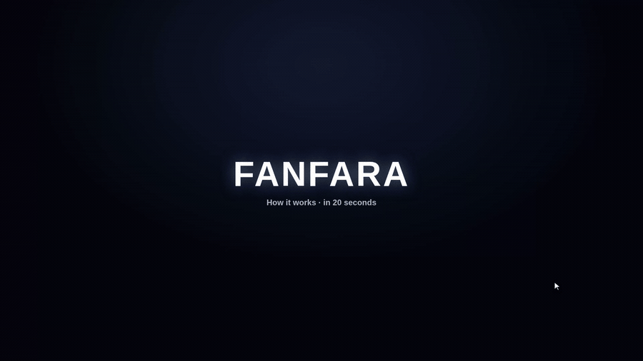
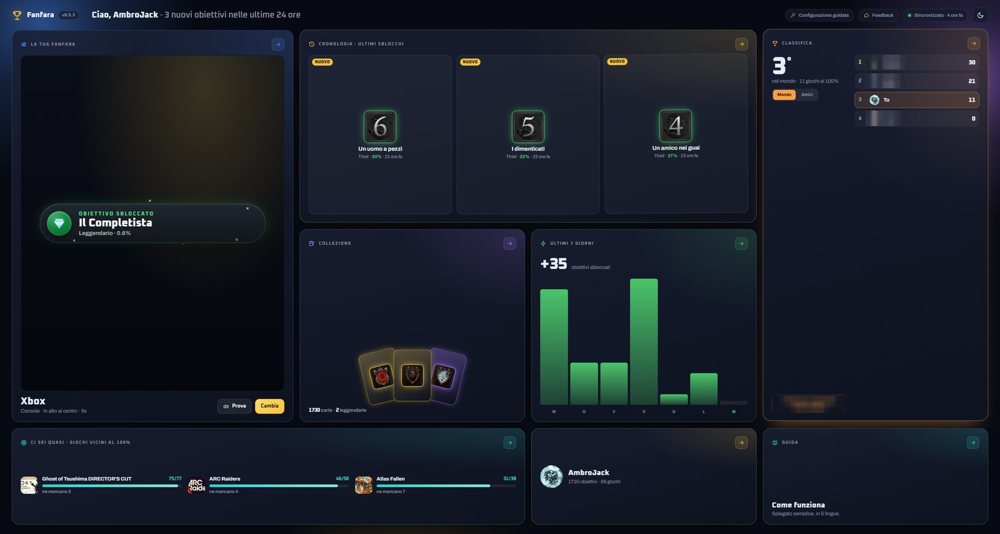
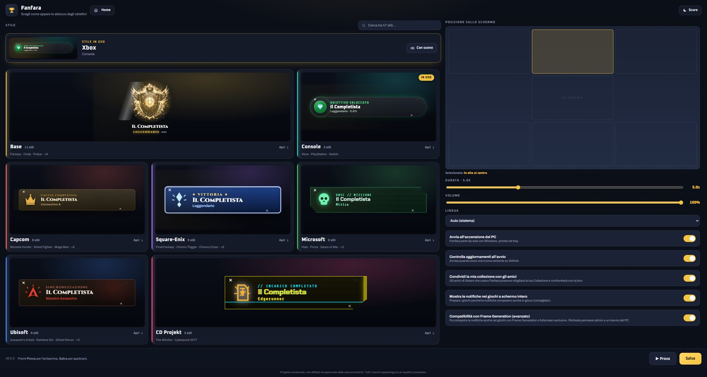
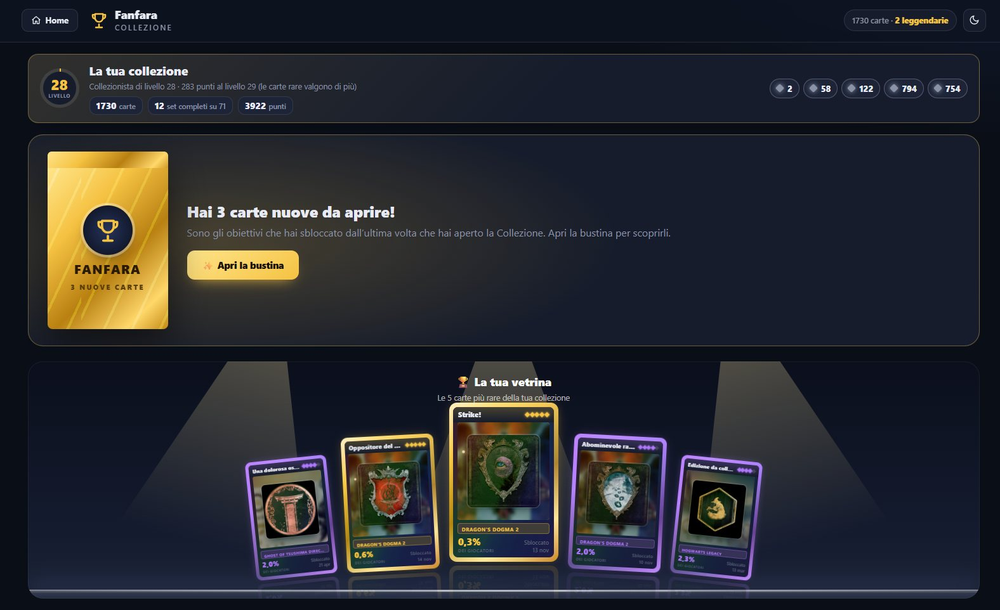
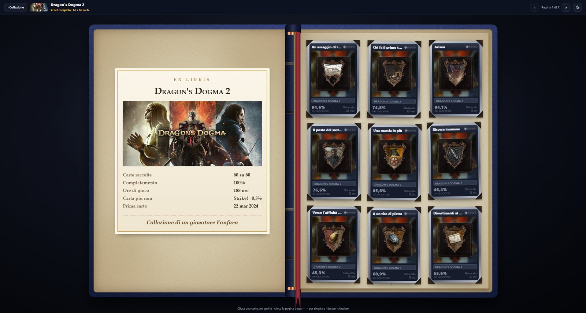
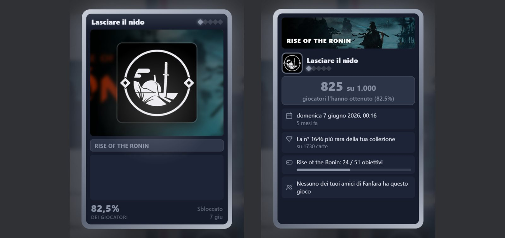
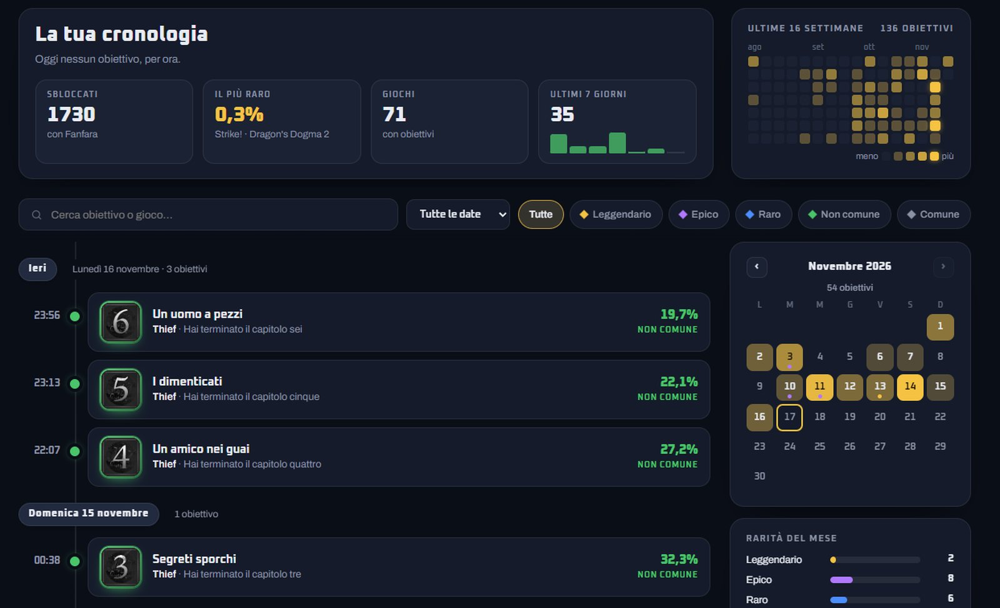

# 🎉 Fanfara

<p align="center">
  
</p>

<p align="center">
  <a href="../../releases/latest"></a>
  
  
  <a href="LICENSE"></a>
</p>

[🇬🇧 Read in English](README.md) · **🇮🇹 Italiano**

**Rendi gli sblocchi degli obiettivi su Steam spettacolari come su Xbox e PlayStation.**

Su Steam, quando sblocchi un obiettivo compare una piccola notifica anonima nell'angolo. Fanfara la
sostituisce con una notifica animata e festosa il cui **stile, icona e suono cambiano in base alla
rarità**: più l'obiettivo è raro (meno giocatori al mondo ce l'hanno), più lo sblocco è epico.

È un'**app Windows leggera e nativa**: la avvii, giochi, e pensa a tutto lei. Intorno alle notifiche
costruisce tutta la tua vita da cacciatore di obiettivi — una **linea del tempo** di ogni sblocco, una
**Collezione** di carte rilegate in album antichi, una **classifica** dei giochi completati al 100% e le
**collezioni dei tuoi amici** da confrontare con la tua. Niente login, niente chiave API, niente da
configurare.

---

## Indice

- [Novità](#-novità)
- [Immagini](#-immagini)
- [Scarica e installa](#%EF%B8%8F-scarica-e-installa)
- [Primo avvio](#-primo-avvio)
- [Funzioni](#-funzioni)
- [Privacy: cosa resta sul tuo PC e cosa va online](#-privacy-cosa-resta-sul-tuo-pc-e-cosa-va-online)
- [Problemi comuni](#-problemi-comuni)
- [Per sviluppatori](#%EF%B8%8F-per-sviluppatori)
- [Licenza](#licenza)

---

## 🆕 Novità

**0.6.0** — **Stili degli album**: oltre al classico, «Ferro e cuoio», «Grimorio reale» e «Archivio
olografico», con sfondi animati. La **Super Fanfara** festeggia ogni gioco completato al 100%. Una
notifica (anche in gioco) quando un **amico completa un gioco al 100%**, una **campanella** con tutte
le novità nella Home e gli **aggiornamenti con un clic**, che si installano da soli e ti mostrano le
novità.

**0.5.3** — **Collezioni degli amici**: apri la collezione di un amico di Steam dalla classifica Amici
e confrontala con la tua carta per carta. I problemi di privacy di Steam vengono riconosciuti in ogni
forma.

**0.5.2** — una **Cronologia a linea del tempo** tutta nuova con calendario di 16 settimane; testi,
carte e copertine più nitidi ovunque; zoom Ctrl +/−, F12 e scorciatoie del browser disattivati;
premendo di nuovo **Prova** la prova riparte invece di mettersi in coda.

**0.5.1** — una **configurazione guidata** al primo avvio, un avviso chiaro quando Steam nasconde i
tuoi obiettivi, le notifiche sullo schermo dove stai giocando e la **Collezione ad album antichi**.

**0.5.0** — Collezione a carte da collezione con retro e «quali amici ce l'hanno», **Invia feedback**
e aiuto per i giochi a schermo intero esclusivo.

Le note complete di ogni versione: [Releases](../../releases).

---

## 📸 Immagini

| | |
|---|---|
| <br>**Home** — la tua fanfara, ultimi sblocchi, classifica, carte più rare, ultimi 7 giorni | <br>**Personalizza** — 47 stili in 7 categorie, con anteprime animate |
| <br>**Collezione** — livello collezionista, vetrina e un album per gioco | <br>**Un album** — un libro antico con le carte negli angolini |
| <br>**Una carta, fronte e retro** — rarità, data, progresso, amici che ce l'hanno | <br>**Cronologia** — la linea del tempo di ogni sblocco |

---

## ⬇️ Scarica e installa

1. Apri l'**[ultima versione](../../releases/latest)**.
2. Scarica:
   - **`FanfaraSetup.exe`** — l'installer (consigliato). Tiene Fanfara **aggiornata da sola**; ogni
     aggiornamento è **verificato con un checksum SHA-256** prima di partire.
   - oppure **`Fanfara.zip`** — la versione portatile: estraila e avvia `Fanfara.exe`.
3. Avviala.

Nient'altro da installare: niente .NET, niente terminale. È tutto incluso. Windows 10 o 11 a 64 bit.

> ⚠️ **La prima volta** Windows potrebbe mostrare l'avviso blu «Windows ha protetto il PC». È normale
> per le app gratuite non firmate con un certificato a pagamento: clicca **«Ulteriori informazioni» →
> «Esegui comunque»**.

---

## 🚀 Primo avvio

La prima volta (e una volta dopo un aggiornamento) si apre una **configurazione guidata**. Passo
passo:

1. controlla che Steam sia aperto e che i tuoi obiettivi siano **visibili** — se la privacy di Steam
   li nasconde, ti dice esattamente quali voci mettere su Pubblico, con un pulsante per la pagina
   giusta;
2. ti fa **provare la notifica** e scegliere lo **schermo** dove vederla;
3. spiega le **modalità video** dei giochi (e prepara i giochi perché la notifica si veda in gioco);
4. imposta **avvio con Windows**, **volume**, **aggiornamenti**, la **classifica mondiale** pubblica
   (spenta finché non entri) e la **condivisione della collezione con gli amici** (accesa, puoi
   spegnerla);
5. importa **tutti i tuoi obiettivi passati** di Steam, mostrando l'avanzamento.

Puoi riaprirla quando vuoi dal pulsante **Configurazione guidata** in alto nella Home, dalla Guida o
dal menu dell'icona di Fanfara vicino all'orologio.

Poi Fanfara vive in **una sola finestra** — Home, Personalizza, Cronologia, Collezione, Classifica e
Guida — e resta attiva con un'icona vicino all'orologio quando la chiudi. Avvia un gioco e la fanfara
comparirà al primo obiettivo. 🎮

> **Consiglio:** per non avere due notifiche, spegni quella di Steam:
> **Steam → Impostazioni → In gioco** (o **Notifiche**) → notifica di sblocco obiettivi spenta.

---

## ✨ Funzioni

### 🎺 Notifiche
- **47 stili in 7 categorie** con anteprime animate e ricerca:
  **Base (con Fantasy) · Console · Capcom · Square-Enix · Microsoft · Ubisoft · CD Projekt**.
- Ogni stile ha il **suo riquadro**, un **emblema diverso per ogni rarità** e un **suono incluso** —
  tutti animati. Niente scelta separata del suono: il suono fa parte dello stile.
- **5 livelli di rarità** — Comune, Non comune, Raro, Epico, Leggendario — che cambiano emblema,
  colore, intensità ed effetti. **Il Leggendario ha sempre qualcosa in più** ✨.
- I pacchetti ispirati ai giochi usano **emblemi e suoni originali**, mai loghi o audio ufficiali.
- **7 posizioni**, durata regolabile (fino a 12 s), volume e **Prova** per provarla quando vuoi
  (premendolo di nuovo la prova riparte).
- Compare sui giochi **a schermo intero e in finestra senza bordi**, sullo **schermo dove stai
  giocando**.

### 🏠 Home
Una schermata con la tua fanfara (dal vivo, con **Prova**), gli ultimi sblocchi con le icone vere, la
tua posizione nelle classifiche Mondiale e Amici, le carte più rare, gli ultimi 7 giorni e i giochi
più vicini al 100%. Ogni riquadro apre la sua sezione.
- **🔔 La campanella** raccoglie i 100% degli amici, i tuoi, le nuove versioni e le novità; clicchi e
  vai al punto giusto.
- **Aggiornamenti con un clic**: «Aggiorna ora» scarica, verifica, installa e riapre Fanfara da sola
  (mai durante un gioco), poi ti mostra le note della versione nella tua lingua.

### 🕒 Cronologia
Una **linea del tempo** di ogni sblocco: l'ora e un pallino del colore della rarità, mentre gli sblocchi
**epici e leggendari** diventano riquadri grandi con l'immagine del gioco. In alto: il riepilogo di
oggi, le statistiche e un **calendario di 16 settimane** (più obiettivi, più il giorno è acceso). A
lato: il **calendario del mese** (sfogli i mesi, clicchi un giorno per vedere solo quello), la rarità e
i giochi del mese. Ricerca, filtri di rarità e di data; i giorni si caricano una settimana alla volta,
così resta veloce anche con migliaia di sblocchi.

### 🃏 Collezione
Tutto il tuo catalogo Steam come **carte da collezione**: cornice metallica del colore della rarità,
gemme, l'icona vera sull'immagine del gioco ed effetti che crescono con la rarità.
- **Clicca una carta**: si solleva, gira e atterra davanti a te; **girala** per la storia di quello
  sblocco — quanti giocatori su 1.000 ce l'hanno, data e ora, la sua posizione nella collezione, il tuo
  progresso nel gioco, il nastro «completato al 100%» e **quali amici ce l'hanno, e chi è arrivato
  primo**.
- **Copia immagine** (la incolli dove vuoi) e **Pubblica in bacheca** sul server Discord di Fanfara —
  solo dopo aver verificato su Steam che l'obiettivo sia davvero tuo.
- Il tuo **livello collezionista** (le carte rare valgono di più), una **bustina** da strappare con le
  carte sbloccate dall'ultima visita e una **vetrina** illuminata con le tue 5 carte più rare.
- **Un album per gioco**, come un **libro antico rilegato in pelle** che apri tu: fermaglio in ottone,
  fregi dorati, rilegatura cucita, carte negli angolini in ordine di sblocco, cornici «?» per quelle
  mancanti, un Ex Libris con carte, completamento, **ore di gioco**, carta più rara e prima carta, e
  pagine da sfogliare. Le copertine usano l'immagine grande della libreria di Steam con il logo del
  gioco.
- **📖 Stili degli album** (Personalizza → Stile degli album): **Classico**, **Ferro e cuoio**,
  **Grimorio reale** e **Archivio olografico** — ognuno con copertina, pagine, cornice e sfondo animato
  (candele, polvere, scintille). Gli effetti possono essere Pieni, Leggeri o Spenti.

### 🏅 Super Fanfara e amici al 100%
- **Super Fanfara**: quando sblocchi l'ultimo obiettivo di un gioco, un «100%» dorato riempie lo
  schermo con l'immagine del gioco, le ore giocate, il numero di quel 100% per te, coriandoli e una
  fanfara orchestrale.
- **Amici al 100%**: quando un amico di Steam che usa Fanfara completa un gioco al 100%, compare una
  scheda in basso a destra — anche in gioco — con i suoi 100% contro i tuoi e due rintocchi leggeri.
  Si possono spegnere entrambe (quella degli amici anche solo nel suono) in Personalizza.

### 🏆 Classifica e collezioni degli amici
- Una classifica per **numero di giochi completati al 100%**: i tuoi giochi completati come carte, una
  classifica **Mondiale** pubblica (solo se entri) e una classifica **Amici** con gli amici di Steam che
  usano Fanfara. Ogni Fanfara calcola il proprio punteggio sul tuo PC.
- **📚 Collezioni degli amici** — nella classifica Amici, **Collezione** apre la collezione di un amico
  (vetrina, album, carte) e la **confronta con la tua**: carte in comune, carte che ti mancano, carte
  solo tue, il bollino «Ce l'hai / Ti manca» su ogni carta, il tuo progresso sotto ogni album e un
  filtro per i giochi che avete entrambi.

### ☁️ Importazione e sincronizzazione automatiche
La prima volta Fanfara **importa tutti i tuoi obiettivi passati** (icone vere, date di sblocco, rarità
mondiale). Poi cattura i nuovi sblocchi dal vivo, **aggiorna un gioco appena lo chiudi** e ricontrolla
tutto ogni 12 ore, anche se resta aperta.

### 🧰 Tutto il resto
- **5 lingue** — italiano, inglese, francese, tedesco, spagnolo — segue Windows o la tua scelta. È tutto
  tradotto, fino ai nomi dei gradi di ogni stile. Anche l'installer.
- **Tema chiaro e scuro** ovunque, **avvio con Windows**, **aggiornamenti automatici**.
- Un **avviso rosso** chiaro nella Home se Steam nasconde i tuoi obiettivi, con *Come risolvere*.
- **💬 Invia feedback** dalla Home, dalla Guida o dal menu dell'icona (problema / idea / altro), se vuoi
  con il registro tecnico ripulito dai dati personali.
- Una **Guida** nell'app, in 5 lingue, che spiega ogni funzione.

---

## 🔒 Privacy: cosa resta sul tuo PC e cosa va online

| | Dove | Cosa |
|---|---|---|
| Cronologia, collezione, impostazioni | **Solo sul tuo PC** | `history.json`, `games.json` (in `%AppData%\Fanfara`), `config.json` (accanto all'app) |
| Lettura dei tuoi obiettivi | Proxy di Fanfara → Steam | Il tuo **SteamID** (pubblico) per leggere i tuoi dati Steam **pubblici**; non viene salvato niente |
| Classifica amici | Database di Fanfara | SteamID, nome e avatar di Steam, giochi al 100% (e quali, per le notifiche «amici al 100%») — visibili solo ai tuoi amici di Steam che usano Fanfara |
| Classifica mondiale | Database di Fanfara | Gli stessi dati, visibili a tutti — **solo se entri**; quando esci sparisci dalla classifica (i tuoi amici ti vedono ancora) |
| Collezioni degli amici | Database di Fanfara | Una copia leggera della tua collezione, leggibile **solo dai tuoi amici di Steam** — accesa di base, se la spegni in Personalizza viene cancellata |
| Feedback / bacheca | Database di Fanfara + Discord | Solo quello che invii; lo SteamID viene tenuto solo come codice anonimo |
| Aggiornamenti | GitHub | Controllo di una nuova versione e lettura delle sue note |
| Notifiche (campanella) | **Solo sul tuo PC** | `notifications.json`, `friends-perf.json` in `%AppData%\Fanfara` |

La parte online di Fanfara è un piccolo servizio personale su Cloudflare (`proxy/`): tiene segreta la
chiave della Steam Web API, così tu non ne hai mai bisogno.

---

## 🧩 Problemi comuni

**Fanfara ha importato 0 obiettivi / mostra l'avviso rosso della privacy.**
Su Steam: *Profilo → Modifica profilo → Impostazioni privacy* → metti su **Pubblico** sia **Il mio
profilo** sia **Dettagli dei giochi**. Aspetta qualche minuto, poi premi **Ricontrolla** nella Home.

**Sento la fanfara ma non la vedo.**
- Il gioco è a **schermo intero esclusivo**: nelle opzioni video scegli **Schermo intero** senza
  «esclusivo» (a volte si chiama **Finestra senza bordi**). Gira comunque alla frequenza del monitor.
- Il gioco era già aperto quando Fanfara l'ha preparato: **riavvia il gioco** una volta.
- Alcuni giochi con **Frame Generation** (DLSS 3, FSR 3) nascondono gli overlay: accendi
  **«Compatibilità con Frame Generation»** in Personalizza (servono i permessi di amministratore e un
  riavvio).
- Con più monitor, scegli lo schermo nella **configurazione guidata**.

**Non vedo il pulsante «Collezione» accanto a un amico.**
Serve che abbia Fanfara **0.5.3 o successiva** con la condivisione accesa, e che abbia sincronizzato
almeno una volta.

**Dov'è il registro?** `C:\Users\<tuo nome>\fanfara-log.txt` — oppure usa **Invia feedback** e
allegalo.

---

## 🛠️ Per sviluppatori

Serve il **.NET 8 SDK** (gratuito): <https://dotnet.microsoft.com/download>. In `src/`:

```bat
dotnet run
```

la avvia in sviluppo; `dotnet publish -c Release` crea il pacchetto autonomo e portatile.

L'app deve girare **sul PC dove gira Steam**: parla con il gioco in esecuzione tramite l'API Steamworks
*come se fosse quel gioco* (nessuna chiave). L'importazione dello storico usa la Steam **Web** API in
sola lettura, tramite il proxy in [`proxy/`](proxy/README.md).

**Pubblicare una versione** — pubblica una **Release** su GitHub con un tag che inizia per `v` (es.
`v0.5.3`): `.github/workflows/build.yml` compila sui server Windows di GitHub, allega `Fanfara.zip`,
`FanfaraSetup.exe` e `FanfaraSetup.exe.sha256` e annuncia la versione su Discord.

### Come funziona

- `SteamWatcher.cs` / `SteamWorker.cs` — un **processo separato** inizializza Steamworks come il gioco
  in esecuzione, controlla ogni secondo i nuovi sblocchi (con la rarità mondiale) e li comunica; l'app
  principale non carica mai Steam, così i giochi non risultano mai «ancora in esecuzione».
- `OverlayWindow` + `web/notify.html` — una finestra trasparente, sempre in primo piano e
  attraversabile dal mouse, con una WebView2 che disegna le notifiche sullo schermo giusto.
- **La finestra unica** — una WebView2 che passa tra `web/home.html` (dati da `HomeData.cs`),
  `settings.html` (stili in `styles.js`), `history.html`, `collection.html`, `classifica.html`,
  `guide.html`, `feedback.html` e `welcome.html` (configurazione guidata). Testi in `i18n.js` e nelle
  pagine, 5 lingue, tema chiaro/scuro. `WebLock.cs` disattiva zoom, F12 e scorciatoie del browser.
- `SteamId.cs` — trova il tuo SteamID64 in locale (registro / `loginusers.vdf`).
- `SteamHistory.cs` + `AchievementStore.cs` + `GamesStore.cs` — importazione e archivi locali
  (`history.json`, `games.json` con progresso e minuti giocati); riconosce gli obiettivi nascosti.
- `Leaderboard.cs` — punteggi calcolati in locale e registrati tramite il proxy in un database **D1** di
  Cloudflare.
- `CollectionShare.cs` — invia una copia compatta e compressa della collezione (~150 KB per ~1.700
  carte) solo se la condivisione è accesa e qualcosa è cambiato; legge la collezione di un amico solo
  se siete amici su Steam.
- `CardShare.cs`, `Feedback.cs` — pubblicazioni in bacheca e feedback, tramite il proxy.
- `FsOpt.cs` / `Mpo.cs` — preparano i giochi per lo schermo intero e l'opzione Frame Generation.
- `Updater.cs` — scarica il nuovo installer, **ne verifica lo SHA-256**, lo avvia in silenzio dopo la
  chiusura di Fanfara (l'installer la riapre) e legge le note della versione per le «Novità».
- `Notifications.cs` / `FriendWatch.cs` — l'elenco della campanella e il controllo «amici al 100%»
  (ogni 5 minuti, dalla classifica Amici).
- `proxy/worker.js` — il Worker Cloudflare (piano gratuito): proxy della Steam Web API con la chiave
  segreta, classifica, collezioni degli amici, feedback e bacheca. Vedi
  [`proxy/README.md`](proxy/README.md).

---

> ℹ️ Progetto amatoriale, non affiliato né approvato da Valve, Steam o dalle case produttrici. Tutti i
> marchi appartengono ai rispettivi proprietari.

## Licenza
MIT — vedi [`LICENSE`](LICENSE). Libero da usare, modificare e condividere.

### Riconoscimenti
La musica della Super Fanfara è un brano originale suonato con il soundfont **MuseScore General** di
S. Christian Collins (licenza MIT). Tutti gli altri suoni ed emblemi sono originali.
