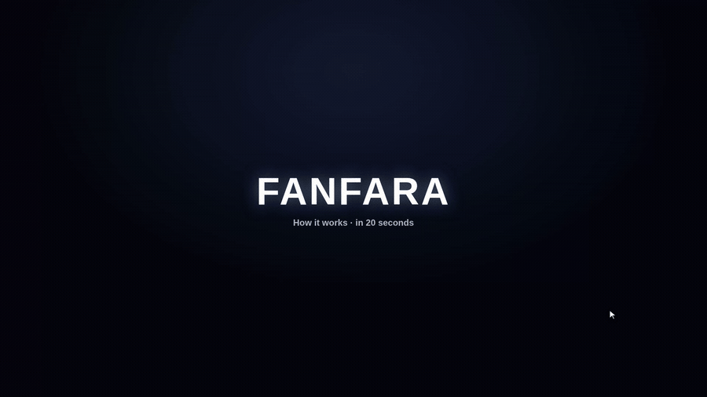
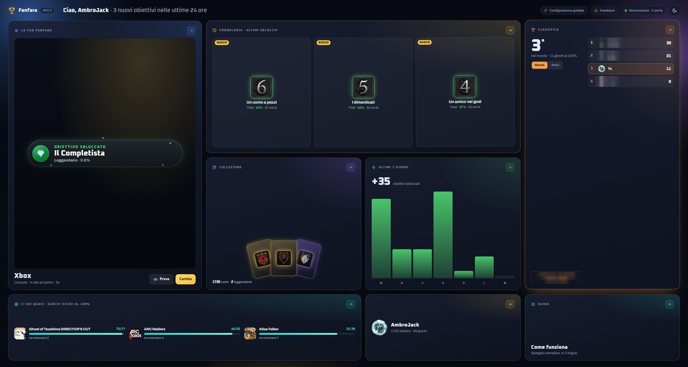
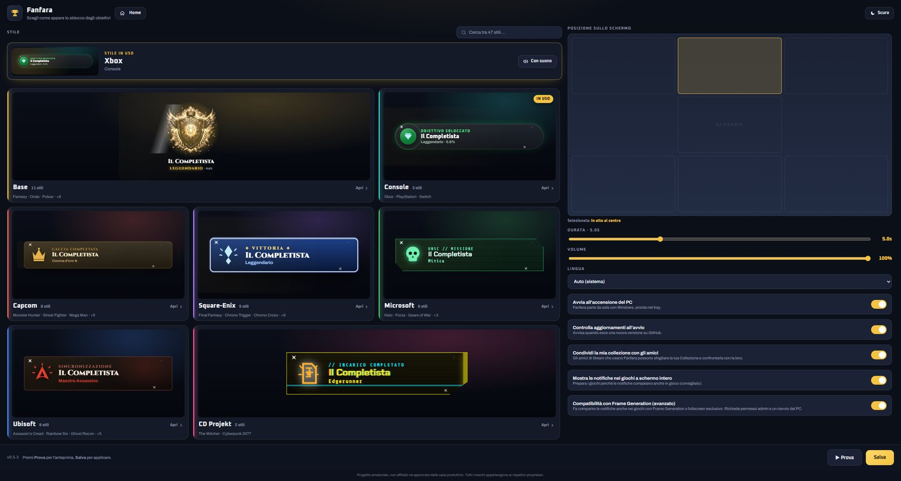
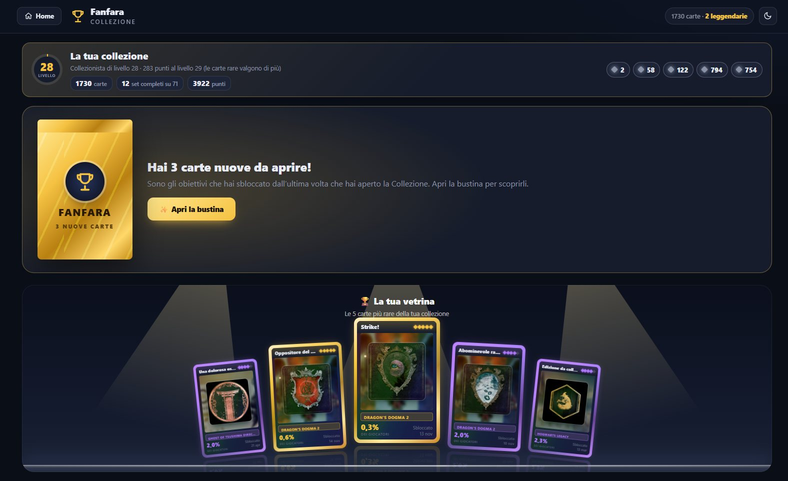
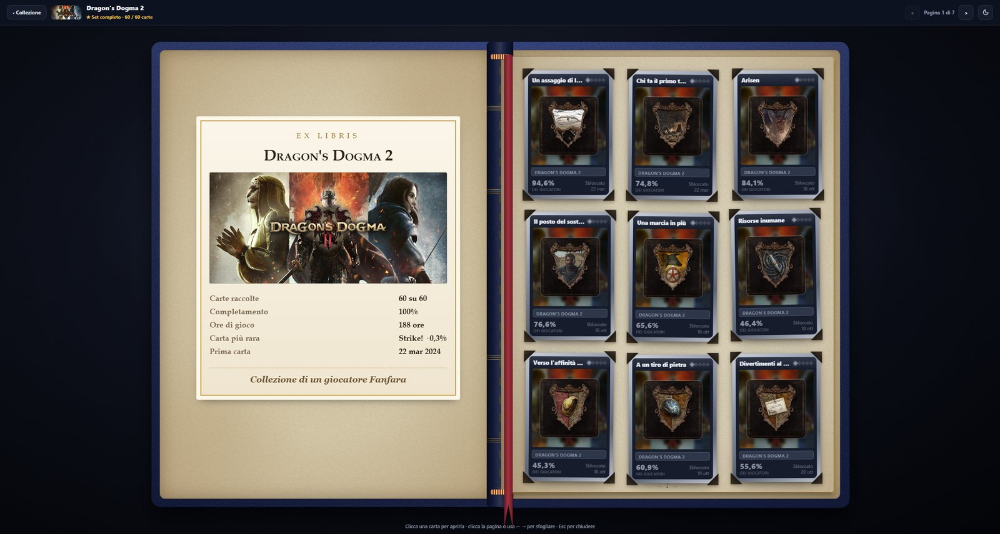
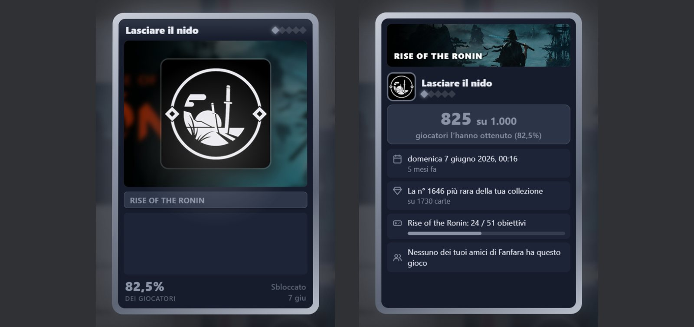
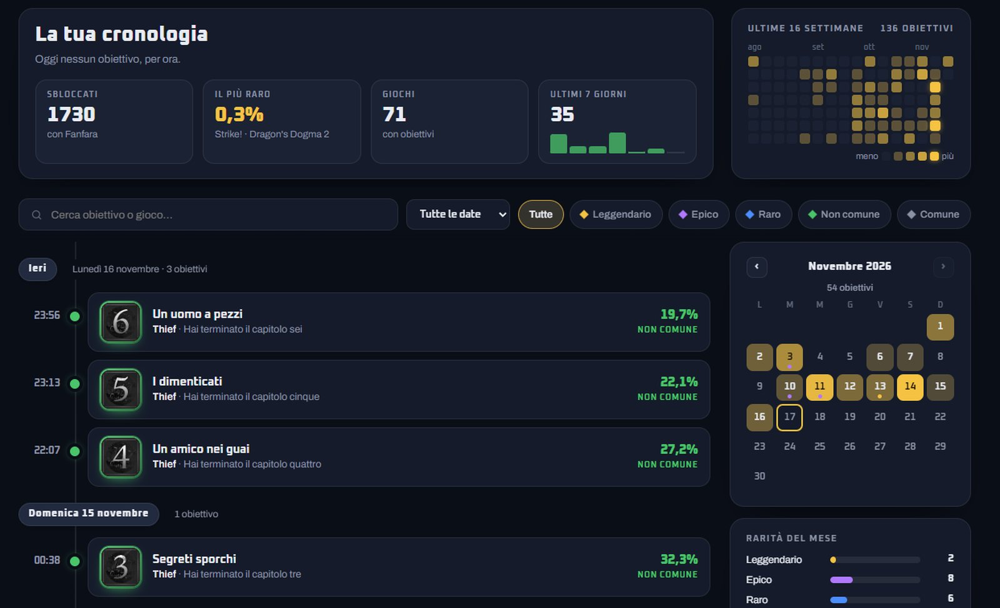

# 🎉 Fanfara

<p align="center">
  
</p>

<p align="center">
  <a href="../../releases/latest"></a>
  
  
  <a href="LICENSE"></a>
</p>

**🇬🇧 English** · [🇮🇹 Leggi in italiano](README.it.md)

**Make Steam achievement unlocks as spectacular as on Xbox and PlayStation.**

On Steam, unlocking an achievement shows a small, anonymous notification in the corner. Fanfara
replaces it with a celebratory, animated notification whose **style, icon and sound change with the
achievement's rarity**: the rarer it is (the fewer players worldwide have earned it), the more epic
the unlock.

It's a **lightweight, native Windows app**: launch it, play, and it takes care of the rest. Around the
notifications it builds your whole achievement life — a **timeline** of every unlock, a **Collection**
of trading cards bound in antique albums, a **leaderboard** of games completed 100% and your **friends'
collections** to compare with yours. No login, no API key, nothing to configure.

---

## Contents

- [What's new](#-whats-new)
- [Screenshots](#-screenshots)
- [Download and install](#%EF%B8%8F-download-and-install)
- [First start](#-first-start)
- [Features](#-features)
- [Privacy: what stays on your PC, what goes online](#-privacy-what-stays-on-your-pc-what-goes-online)
- [Troubleshooting](#-troubleshooting)
- [For developers](#%EF%B8%8F-for-developers)
- [License](#license)

---

## 🆕 What's new

**0.5.3** — **Friends' collections**: open a Steam friend's collection from the Friends leaderboard
and compare it with yours card by card. Steam privacy problems are recognised in every form.

**0.5.2** — a brand-new **History timeline** with a 16-week calendar; sharper text, cards and album
covers everywhere; Ctrl +/− zoom, F12 and browser shortcuts are off; pressing **Test** again restarts
the test instead of queueing it.

**0.5.1** — a **guided setup** on first start, a clear warning when Steam hides your achievements,
notifications on the screen where you're playing, and the **antique-album Collection**.

**0.5.0** — trading-card Collection with flip and «which friends have it», **Send feedback**, and help
for games in exclusive fullscreen.

Full notes for every version: [Releases](../../releases).

---

## 📸 Screenshots

| | |
|---|---|
| <br>**Home** — your fanfare, latest unlocks, rank, rarest cards, last 7 days | <br>**Personalizza** — 47 styles in 7 categories, with live previews |
| <br>**Collezione** — collector level, showcase and one album per game | <br>**An album** — an antique book with your cards in photo corners |
| <br>**A card, front and back** — rarity, date, progress, friends who have it | <br>**Cronologia** — the timeline of every unlock |

---

## ⬇️ Download and install

1. Open the **[latest release](../../releases/latest)**.
2. Download:
   - **`FanfaraSetup.exe`** — the installer (recommended). It keeps Fanfara **up to date
     automatically**; every update is **verified with a SHA-256 checksum** before it runs.
   - or **`Fanfara.zip`** — the portable version: extract it and run `Fanfara.exe`.
3. Launch it.

Nothing else to install: no .NET, no terminal. Everything is bundled. Windows 10 or 11, 64-bit.

> ⚠️ **The first time**, Windows may show the blue «Windows protected your PC» warning. This is
> normal for free apps that aren't signed with a paid certificate: click **«More info» → «Run anyway»**.

---

## 🚀 First start

A **guided setup** opens the first time (and once after an update). Step by step it:

1. checks that Steam is running and that your achievements are **visible** — if Steam's privacy
   hides them, it tells you exactly which settings to make Public, with a button to the right page;
2. lets you **test the notification** and choose the **screen** it appears on;
3. explains the games' **display modes** (and prepares your games so notifications show in-game);
4. sets **start with Windows**, **volume**, **updates**, the public **world leaderboard** (off unless
   you join) and **sharing your collection with friends** (on, you can turn it off);
5. imports **all your past Steam achievements**, with live progress.

You can reopen it any time from the **Guided setup** button at the top of Home, the Guide or the
menu of Fanfara's icon next to the clock.

Fanfara then lives in **one window** — Home, Personalizza, Cronologia, Collezione, Classifica and
Guida — and keeps running with an icon near the clock when you close it. Start a game and the
fanfare appears at your first unlock. 🎮

> **Tip:** to avoid two notifications, turn off Steam's own:
> **Steam → Settings → In Game** (or **Notifications**) → achievement-unlock notification off.

---

## ✨ Features

### 🎺 Notifications
- **47 styles in 7 categories** with live animated previews and search:
  **Base (incl. Fantasy) · Console · Capcom · Square-Enix · Microsoft · Ubisoft · CD Projekt**.
- Every style has its **own box**, a **different emblem for each rarity** and a **built-in sound** —
  all animated. No separate sound picker: the sound is part of the style.
- **5 rarity tiers** — Common, Uncommon, Rare, Epic, Legendary — that change emblem, colour, intensity
  and effects. **Legendary always has something extra** ✨.
- Game-inspired packs use **original emblems and sounds**, never official logos or audio.
- **7 positions**, adjustable duration (up to 12 s), volume, and **Test** to try it any time (pressing
  it again restarts the test).
- Shows over **fullscreen and borderless** games and on the **screen where you're playing**.

### 🏠 Home
One screen with your current fanfare (live, with **Test**), your latest unlocks with their real
icons, your rank in the World and Friends leaderboards, your rarest cards, the last 7 days and the
games closest to 100%. Every tile opens its section.

### 🕒 Cronologia (History)
A **timeline** of every unlock: the time and a dot in the rarity colour, while **epic and legendary**
unlocks become big cards with the game's artwork. On top: today's summary, your stats and a
**16-week calendar** (the more you unlocked, the brighter the day). On the side: the **month
calendar** (browse months, click a day to see only that day), the month's rarity mix and top games.
Search, rarity and date filters; days load a week at a time, so it stays fast with thousands of
unlocks.

### 🃏 Collezione (Collection)
Your whole Steam catalogue as **trading cards**: a metallic frame in the rarity colour, rarity gems,
the real icon over the game artwork, and effects that grow with rarity.
- **Click a card** and it lifts off, spins and lands in front of you; **flip it** for the story of that
  unlock — how many players in 1,000 have it, date and time, its place in your collection, your
  progress in the game, the «completed 100%» ribbon and **which friends have it, and who got it first**.
- **Copy image** (paste it anywhere) and **Post to the showcase** on the Fanfara Discord server — only
  after checking on Steam that the achievement is really yours.
- Your **collector level** (rare cards are worth more), a **pack** to tear open with the cards unlocked
  since your last visit, and a lit **showcase** of your 5 rarest cards.
- **One album per game**, as an **antique leather-bound book** you open yourself: brass clasp, gold
  tooling, sewn binding, cards in photo corners in unlock order, «?» frames for the missing ones, a
  bookplate with cards, completion, **hours played**, rarest and first card, and pages you turn.
  Covers use Steam's large library artwork with the game's logo.

### 🏆 Classifica (Leaderboard) and friends' collections
- A ranking by **number of games completed 100%**: your completed games as cards, a public **World**
  board (only if you join) and a **Friends** board with the Steam friends who use Fanfara. Each copy
  of Fanfara computes its own score on your PC.
- **📚 Friends' collections** — in the Friends board, **Collection** opens a friend's collection
  (showcase, albums, cards) and **compares it with yours**: cards in common, cards you're missing,
  cards only you have, a «You have it / Missing» badge on every card, your progress under each album
  and a filter for the games you both own.

### ☁️ Automatic import and sync
The first time, Fanfara **imports all your past achievements** (real icons, unlock dates, worldwide
rarity). Then it captures new unlocks live, **refreshes a game as soon as you close it** and checks
everything again every 12 hours, even while it stays open.

### 🧰 Everything else
- **5 languages** — English, Italian, French, German, Spanish — following Windows, or your choice.
  Everything is translated, down to each style's rank names. The installer too.
- **Light and dark theme** everywhere, **start with Windows**, **automatic updates**.
- A clear **red notice** on the Home if Steam hides your achievements, with *How to fix it*.
- **💬 Send feedback** from the Home, the Guide or the tray menu (problem / idea / other), optionally
  with the technical log, cleaned of personal data.
- An in-app **Guide** in 5 languages that explains every feature.

---

## 🔒 Privacy: what stays on your PC, what goes online

| | Where | What |
|---|---|---|
| Your history, collection, settings | **Only on your PC** | `history.json`, `games.json` (in `%AppData%\Fanfara`), `config.json` (next to the app) |
| Reading your achievements | Fanfara's proxy → Steam | Your **SteamID** (public) to read your **public** Steam data; nothing is stored |
| Friends leaderboard | Fanfara's database | SteamID, Steam name and avatar, games at 100% — visible only to your Steam friends who use Fanfara |
| World leaderboard | Fanfara's database | The same, visible to everyone — **only if you join**; when you leave you disappear from it (your friends still see you) |
| Friends' collections | Fanfara's database | A light copy of your collection, readable **only by your Steam friends** — on by default, turn it off in Personalizza and it's deleted |
| Feedback / showcase | Fanfara's database + Discord | Only what you send; your SteamID is kept only as an anonymous hash |
| Updates | GitHub | Checks for a new release |

Fanfara's online part is a small personal Cloudflare service (`proxy/`): it keeps the Steam Web API
key secret, so you never need one.

---

## 🧩 Troubleshooting

**Fanfara imported 0 achievements / shows the red privacy notice.**
On Steam: *Profile → Edit Profile → Privacy Settings* → set both **My profile** and **Game details**
to **Public**. Wait a few minutes, then press **Check again** on the Home.

**I hear the fanfare but don't see it.**
- The game is in **exclusive fullscreen**: in its video options choose **Fullscreen** without
  «exclusive» (sometimes called **Borderless**). It still runs at your monitor's refresh rate.
- The game was already running when Fanfara prepared it: **restart the game** once.
- Some games with **Frame Generation** (DLSS 3, FSR 3) hide overlays: turn on **«Frame Generation
  compatibility»** in Personalizza (admin rights and one restart).
- With more than one monitor, choose the screen in the **guided setup**.

**I don't see the «Collection» button next to a friend.**
They need Fanfara **0.5.3 or later** with sharing on, and to have synced once.

**Where is the log?** `C:\Users\<you>\fanfara-log.txt` — or use **Send feedback** and attach it.

---

## 🛠️ For developers

You need the **.NET 8 SDK** (free): <https://dotnet.microsoft.com/download>. In `src/`:

```bat
dotnet run
```

runs it in development; `dotnet publish -c Release` builds the self-contained, portable package.

The app must run **on the PC where Steam runs**: it talks to the running game through the
Steamworks API *as that game* (no key needed). The history import uses the Steam **Web** API
read-only, through the proxy in [`proxy/`](proxy/README.md).

**Publishing a version** — publish a GitHub **Release** with a tag starting with `v` (e.g. `v0.5.3`):
`.github/workflows/build.yml` builds on GitHub's Windows servers, attaches `Fanfara.zip`,
`FanfaraSetup.exe` and `FanfaraSetup.exe.sha256`, and announces the release on Discord.

### How it works

- `SteamWatcher.cs` / `SteamWorker.cs` — a **separate worker process** initialises Steamworks as the
  running game, checks for new unlocks every second (with worldwide rarity) and reports them; the
  main app never loads Steam itself, so games never look «still running».
- `OverlayWindow` + `web/notify.html` — a transparent, always-on-top, click-through window with a
  WebView2 that draws the notifications on the right screen.
- **The single window** — one WebView2 that moves between `web/home.html` (fed by `HomeData.cs`),
  `settings.html` (styles in `styles.js`), `history.html`, `collection.html`, `classifica.html`,
  `guide.html`, `feedback.html` and `welcome.html` (guided setup). Texts in `i18n.js` and per page,
  5 languages, light/dark theme. `WebLock.cs` turns off zoom, F12 and browser shortcuts.
- `SteamId.cs` — finds your SteamID64 locally (registry / `loginusers.vdf`).
- `SteamHistory.cs` + `AchievementStore.cs` + `GamesStore.cs` — import and local stores
  (`history.json`, `games.json` with progress and minutes played); detects hidden achievements.
- `Leaderboard.cs` — scores computed locally and registered through the proxy in a Cloudflare **D1**
  database.
- `CollectionShare.cs` — sends a compact, gzipped copy of your collection (~150 KB for ~1,700 cards)
  only if sharing is on and something changed; reads a friend's collection only if you're Steam friends.
- `CardShare.cs`, `Feedback.cs` — showcase posts and feedback, through the proxy.
- `FsOpt.cs` / `Mpo.cs` — prepare games for fullscreen and the Frame Generation option.
- `Updater.cs` — downloads the new installer and **verifies its SHA-256** before running it.
- `proxy/worker.js` — the Cloudflare Worker (free tier): Steam Web API proxy with the key as a secret,
  leaderboard, friends' collections, feedback and showcase. See [`proxy/README.md`](proxy/README.md).

---

> ℹ️ Hobby project, not affiliated with or endorsed by Valve, Steam or the game companies. All
> trademarks belong to their respective owners.

## License
MIT — see [`LICENSE`](LICENSE). Free to use, modify and share.
